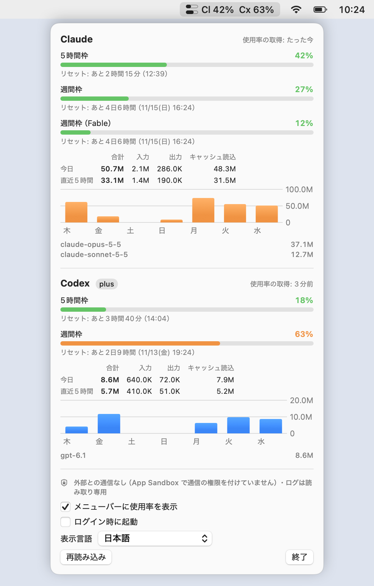
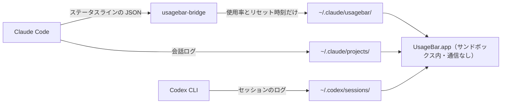

# UsageBar

[English](README.md) | **日本語**

UsageBar は、Claude Code と Codex CLI の利用上限をどれだけ使ったかを、Mac のメニューバーに出すアプリです。応答があるたびに、1 秒以内に表示が変わります。

このアプリは外部と一切通信しません。それをコードの作りだけでなく macOS が保証しています。アプリは通信の権限を付けずに App Sandbox の中で動かしているからです。認証情報にも触れません。使用率の数値は、2 つの CLI が手元にすでに書いているものを読みます。

<picture>
  <source media="(prefers-color-scheme: dark)" srcset="docs/screenshot-ja-dark.png">
  
</picture>

<sub>画面の値はすべて架空のものです。</sub>

## 表示するもの

- **メニューバー**: 2 本のメーターと使用率を並べます。上が Claude、下が Codex です。それぞれ、最も上限に近い枠の使用率を出します。
- **クリックしたとき**: 枠（5 時間枠・週間枠）ごとの使用率とリセットまでの時間を出します。その下に、今日と直近 5 時間のトークン数、過去 7 日の推移、モデル別の内訳が並びます。
- **更新**: CLI が新しい応答をログに書いてから 1 秒以内に変わります。詳しくは[表示が更新されるタイミング](#表示が更新されるタイミング)にまとめています。
- **表示言語**: 日本語と英語に対応しています。最初は Mac のシステム設定の言語の並びに従います（日本語が英語より上にあれば日本語、それ以外は英語）。ポップオーバーの下の「表示言語」で選び直すこともでき、再起動しなくてもその場で切り替わります。

## なぜ外部と通信しない作りにしたか

使用量を表示するツールの多くは、次の仕組みで動きます。まず、Claude や ChatGPT のサブスクリプションのログイン情報（OAuth のトークンやブラウザのセッション）を読み取ります。そのうえで、各社の使用量を返す API を定期的に呼びます。その API は公開されていないことも多いです。つまり、常に動き続けるプログラムが、次の 3 つを同時に持つことになります。

- 有料プランを使える認証情報
- 外部と通信する権限
- 多くの場合、自動アップデートの仕組みと外部のライブラリ

不具合が 1 つあるだけで、あるいはライブラリや配信される更新が 1 つ乗っ取られるだけで、その認証情報が外に送られるおそれがあります。使用量を見るために入れたツールが、そのまま認証情報を盗む最短の経路になってしまいます。

一方で、使用量を知るためだけなら通信はいりません。数値はすでに手元にあるからです。

- **Codex CLI** は、応答のたびにセッションのログへ、その時点の利用上限（`rate_limits`）を書いています。中身は枠ごとの使用率とリセット時刻です。
- **Claude Code** は、ステータスラインを描き直すたびに、同じ情報（`rate_limits`）をステータスライン用のコマンドに渡しています。

UsageBar は、この手元の数値だけを読みます。「この API しか呼びません」と約束するだけでは足りないので、そもそも通信できない作りにしました。

## 設計上の判断

### 方式の比較

| | ログイン情報を読み、使用量の API を定期的に呼ぶ | ブラウザの Cookie を読み、Web 画面から読み取る | **手元のログとステータスラインを読む（採用）** |
|---|---|---|---|
| 扱う認証情報 | サブスクリプションの OAuth トークン | ブラウザのセッション | **なし** |
| 外部との通信 | 必要 | 必要 | **なし（OS が遮断）** |
| CLI を使っていないあいだの更新 | される | される | されない（最後の値を出し、リセット時刻を過ぎた枠は 0% にする） |
| 動かなくなるきっかけ | 非公開 API の変更 | Web 画面の変更 | CLI のログの形式の変更 |

この方式であきらめたのは、CLI を使っていないあいだの更新だけです。使っていなければ使用量も増えません。変わるのはリセットだけで、それはリセット時刻から計算できます。そのため、この欠点は許容できると判断しました。

### コードの形を決めた判断

1. **「通信しない」ことは、コードではなく OS に守らせる。** アプリには `com.apple.security.app-sandbox` を付け、`network.client` と `network.server` は付けていません。コードに不具合があっても、何かが紛れ込んでも、通信は DNS も含めて macOS が遮断します。
2. **読める場所を 4 か所に絞り、読み取り専用にする。** 許可しているのは `~/.claude/projects/`、`~/.claude/usagebar/`、`~/.codex/sessions/`、`~/.codex/archived_sessions/` です（`Resources/UsageBar.entitlements`）。`~/.codex/auth.json`、`~/.claude/.credentials.json`、Keychain など、認証情報のある場所は読めません。
3. **数値だけを取り出し、会話の本文は読み捨てる。** ログを読むための型には、トークン数・モデル名・時刻・利用上限の項目しか定義していません。指示や応答の本文、ツールの入出力は、メモリにも残さず、どこにも書きません。
4. **Claude の使用率は、小さな中継コマンドで受け取る。** Claude Code は、ステータスライン用のコマンドとして `usagebar-bridge` を起動し、標準入力に JSON を渡します。中継コマンドはそこから使用率とリセット時刻だけを取り出し、`~/.claude/usagebar/claude-rate-limits.json` に本人だけが読み書きできる権限（600）で書きます。Claude Code が起動し、このファイルに書く必要があるので、中継コマンドはサンドボックスの外で動きます。そのため中身を小さく保ち、通信・別プログラムの起動・動的な読み込みに使う API を含まないことを `scripts/verify-security.sh` で確かめています。
5. **どのファイルも、壊れているか細工されている前提で読む。** シンボリックリンクはたどらずに開きます。1 行、1 ファイル、標準入力の大きさには上限を設けています。トークン数と時刻は範囲を抑え、値があふれてアプリが止まることのないようにしています。壊れた行は読み飛ばし、アプリは止めません。
6. **余計なものを入れない。** 外部のパッケージは使わず、Apple のフレームワークだけで作っています。自動アップデート、利用状況の送信、Apple の公証のためのアップロードもありません。手元で組み立てて、手元で署名します。

## 仕組み



| 表示 | 取得元 | 読み方 |
|---|---|---|
| Codex の使用率 | `~/.codex/sessions/**/rollout-*.jsonl` | 応答ごとに書かれる `token_count` イベントの `rate_limits` |
| Codex のトークン数 | 同上 | `last_token_usage`。累計が変わったときだけ数えるので、同じ値の重複や再開したセッションを二重に数えない |
| Claude の使用率 | `~/.claude/usagebar/claude-rate-limits.json` | ステータスラインの入力から `usagebar-bridge` が書き出したもの |
| Claude のトークン数 | `~/.claude/projects/**/*.jsonl` | 応答ごとの `message.usage`。`message.id` と `requestId` で重複を除く |

### 表示が更新されるタイミング

- **CLI が値を書く**: 応答があるたびです。Claude の中継コマンドは、Claude Code がステータスラインを描き直すたびに書きます。
- **UsageBar が気づく**: 1 秒以内です。macOS のファイル変更通知（FSEvents）でフォルダを見張り、書き足された部分だけを読みます。
- **30 秒ごと**: 「リセットまであと何分」を進め、リセット時刻を過ぎた枠を 0% にします。
- **5 分ごと、およびスリープから復帰したとき**: 変更通知の取りこぼしに備えて、全体を読み直します。
- **Claude Code を複数開いているとき**: しばらく応答のないセッションが、古い値でステータスラインを描き直すことがあります。同じ枠の使用率は減らないので、中継コマンドは新しい枠の値を残し、同じ枠なら使用率が大きい方を残します。

## 対象とする範囲

対象: Claude Code と Codex CLI の利用上限（使用率とリセット時刻）と、手元のログにあるトークン数。

対象外:

- **金額の計算**: 料金表が必要になります。料金表を最新に保つには取りに行く（通信する）か、古くなるのを受け入れるかになります。
- **長期間の履歴**: 読むのは直近 8 日分だけです。
- **通知と、ほかのサービスへの対応**

## 制約

- Claude の使用率が届くのは、Claude のサブスクリプション（Pro / Max / Team / Enterprise）でログインしているときだけです。API キーで使っている場合は、トークン数だけを出します。
- Codex は、約 1 週間たったログを `.jsonl.zst` に圧縮します。zstd を展開する機能は Apple のフレームワークにないため、圧縮されたログはトークン数の集計に含めません。使用率は最新のログから読むので影響しません。
- `CLAUDE_CONFIG_DIR` や `CODEX_HOME` でデータの場所を変えている場合は読めません。サンドボックスで読める場所を、上の決まったパスに固定しているためです。
- アプリを起動した時点で `~/.claude/usagebar/` が無いと、Claude の値が初めて表示されるまでに最大 30 秒かかります。2 回目からは 1 秒以内です。

## セキュリティの確かめ方

```bash
scripts/verify-security.sh ~/Applications/UsageBar.app              # 配置して起動しているアプリ
scripts/verify-security.sh --skip-runtime build.noindex/UsageBar.app # 組み立てただけで起動していないアプリ（6 を省く）
scripts/verify-security.sh --binary /usr/bin/nc                     # 実行ファイル 1 つに 3〜5 だけを行う
```

確かめること:

1. App Sandbox が有効で、通信の権限が無い
2. ファイルの読み取りを許可しているのが上の 4 か所だけで、ほかの権限も無い
3. 2 つの実行ファイルが、次の API を参照していない
   - 通信: `socket`、`connect`、`getaddrinfo`、`URLSession`、`Data(contentsOf:)` など
   - 別プログラムの起動: `posix_spawn`、`execve`、`Process`、`NSWorkspace.open`
   - 動的な読み込み: `dlopen`、`NSClassFromString`
   - Keychain の読み出し
4. 2 つの実行ファイルに URL の文字列が無い
5. システムのライブラリだけを読み込み、Network / CFNetwork / WebKit / Security のフレームワークを直接読み込んでいない
6. 指定したアプリが起動していて、サンドボックスの中で動き、ネットワークのソケットを開いていない

3 には例外が 1 つあります。`dlsym` は、呼び出し元が `__initializeAvailabilityCheck` だけのときに限って許します。これはコンパイラに付属する部品（compiler-rt）の関数で、OS のバージョン確認（`#available`）を支えています。SwiftUI も内部で使っており、macOS の決まった関数を 1 つ探すだけです。`dlopen` がある場合や、ほかの場所から `dlsym` を呼んでいる場合は NG にします。

検査に使う道具が失敗したときは、OK にせず NG にします。通信するプログラムに当てると NG になることも確かめています。

- `nc`: `connect` と `getaddrinfo` で NG
- URLSession を使う小さなプログラム: `NSURLSession` と `dataTaskWithURL:` で NG
- `curl`: 埋め込まれた URL で NG

中継コマンドはサンドボックスの外で動くので、通信しないことの主な根拠は 3 と 4 です。ただし、実行時に組み立てた URL は見つけられません。`Sources/UsageBarBridge/main.swift`（約 300 行）もあわせて読んでください。

## インストール

Xcode が必要です（Command Line Tools だけでなく、Xcode 本体）。

```bash
scripts/build-app.sh --install     # 組み立てて ~/Applications/UsageBar.app に配置
open ~/Applications/UsageBar.app
```

`~/Applications` に置くと、Spotlight や Raycast で「usage」と打てば出てきます。組み立て途中のアプリは `build.noindex/` に作ります。このフォルダは Spotlight が索引しないので、検索に出るのは配置したアプリだけです。

### Claude の使用率を表示する

一度だけ次を実行します。

```bash
~/Applications/UsageBar.app/Contents/MacOS/usagebar-bridge install
```

`~/.claude/settings.json` の `statusLine` に中継コマンドを登録します。書き換える前に、元のファイルを `settings.json.usagebar-backup-<日時>` として残します。ファイルを書き直すので、キーの並び順は変わります。また、次のときは書き換えずに止まります。

- 自分のもの以外のステータスライン用のコマンドがすでに登録されている（`--force` を付ければ上書きする）
- 読み込んでから書き込むまでの間に、ファイルが書き換えられた
- 登録しようとした中継コマンドが、ビルド用のフォルダの中にある

`settings.json` がシンボリックリンクのときは、リンク先のファイルを書き換え、元の権限も保ちます。

登録すると、Claude Code の画面下部にも `Opus 5.5 │ 5h 23% ↻2h10m │ 7d 41% │ ctx 12%` のような行が出ます。

```bash
usagebar-bridge status      # 最後に受け取った値を表示
usagebar-bridge uninstall   # 登録を外す
```

## 開発

```bash
swift test                                                       # 単体テスト
swift build --product UsageBar
"$(swift build --show-bin-path)/UsageBar" --render-demo docs     # README の画面を描き直す（架空の値）
build.noindex/UsageBar.app/Contents/MacOS/UsageBar --print-summary   # サンドボックスの中で集計結果を表示
/usr/bin/log show --last 10m --predicate 'subsystem == "local.usagebar"'   # 使用率が更新された記録（数値だけ）
swift scripts/make-icon.swift Resources/AppIcon.icns            # アプリのアイコンを描き直す
```

| ディレクトリ | 内容 |
|---|---|
| `Sources/UsageCore` | ログの解析と集計。画面のコードを含まない |
| `Sources/UsageBar` | メニューバーのアプリ（SwiftUI の `MenuBarExtra`） |
| `Sources/UsageBarBridge` | Claude Code のステータスライン用の中継コマンド |
| `Resources` | `Info.plist`、権限の定義（entitlements）、アプリのアイコン |
| `scripts` | 組み立て、セキュリティの検査、アイコンの生成 |

## セキュリティ

守っていること、既知の制約、脆弱性を非公開で報告する方法は [SECURITY.md](SECURITY.md) にまとめています。

## ライセンス

[MIT](LICENSE)

UsageBar は個人のプロジェクトで、Anthropic とも OpenAI とも関係がなく、承認や支援も受けていません。Claude、Claude Code、Codex、ChatGPT は各社の商標で、ここでは対応している対象を示すためだけに使っています。
