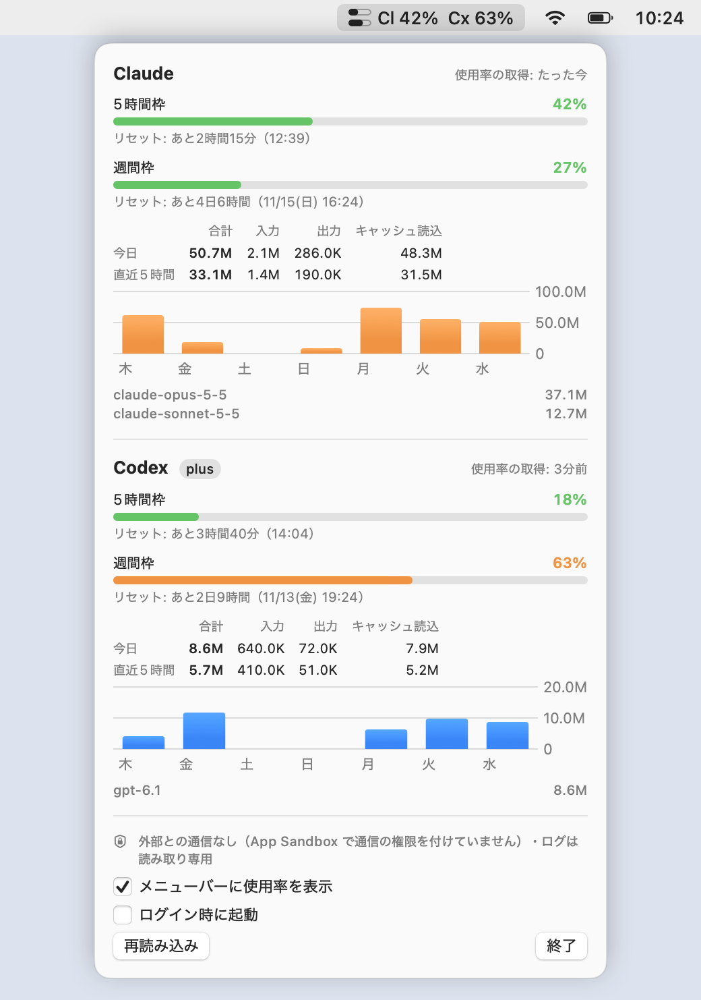
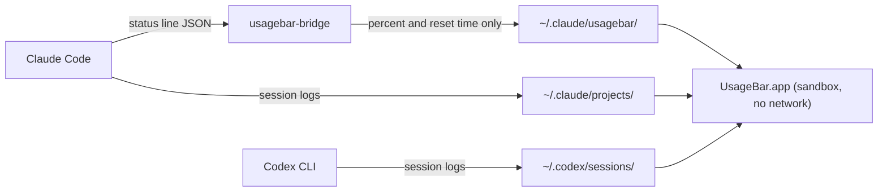

# UsageBar

**English** | [日本語](README.ja.md)

UsageBar is a macOS menu bar app that shows how much of your Claude Code and Codex CLI rate limits you have used, updating within a second of each response.

It never connects to the network. macOS enforces this, not just the code: the app runs in the App Sandbox without the network entitlement. It never touches your credentials. Instead, it reads the usage numbers that the two CLIs already write on your Mac.

<picture>
  <source media="(prefers-color-scheme: dark)" srcset="docs/screenshot-dark.png">
  
</picture>

<sub>All values in the screenshot are made up. The interface is currently in Japanese.</sub>

## What it shows

- **Menu bar:** two meters and two percentages. The top one is Claude and the bottom one is Codex. Each shows the window closest to its limit.
- **Popover:** for each window (5-hour, weekly), how much is used and when it resets. Below that: tokens for today and the last 5 hours, a 7-day chart, and today's tokens per model.
- **Updates:** within a second of the CLI writing a new response. See [When the numbers update](#when-the-numbers-update).

## Why it never touches the network

Tools in this space usually work like this. They read the OAuth token or the browser session of your Claude or ChatGPT subscription. Then they call the provider's usage endpoint on a timer, and those endpoints are often undocumented. So the tool is an always-running process with three things at once:

- a credential that can spend your paid plan,
- access to the network,
- and often an auto-updater and third-party dependencies.

A single bug, or one compromised dependency or update, could send that credential somewhere else. The program you install to watch your usage then becomes the easiest way to steal it.

The network turns out to be unnecessary, because the numbers are already on your disk:

- **Codex CLI** writes the current rate limits (`rate_limits`: used percent and reset time for each window) into its session log after every response.
- **Claude Code** passes the same information (`rate_limits`) to its status line command each time it redraws the status line.

UsageBar reads only these local numbers. Promising "we only call this one endpoint" is not enough, so the app is built so that it *cannot* communicate at all.

## Design decisions

### Approaches compared

| | Read OAuth token, poll usage API | Read browser cookies, scrape web page | **Read local logs and the status line (chosen)** |
|---|---|---|---|
| Credentials handled | Subscription OAuth token | Browser session | **None** |
| Network access | Required | Required | **None (blocked by the OS)** |
| Updates while you are not using the CLI | Yes | Yes | No (shows the last value and treats passed resets as 0%) |
| Breaks when | the private API changes | the web page changes | the CLI's log format changes |

The only thing given up is freshness while you are idle. When you are not using a CLI, its usage is not changing either, except for resets, which UsageBar computes from the reset time. That trade-off was judged acceptable.

### Decisions that shape the code

1. **The OS enforces "no network", not the code.** The app has the `com.apple.security.app-sandbox` entitlement and no `network.client` or `network.server`. Even if the code had a bug or something malicious slipped in, macOS would block every connection, including DNS.
2. **Read access is limited to four directories, read-only.** These are `~/.claude/projects/`, `~/.claude/usagebar/`, `~/.codex/sessions/` and `~/.codex/archived_sessions/` (see `Resources/UsageBar.entitlements`). Places that hold credentials, such as `~/.codex/auth.json`, `~/.claude/.credentials.json` and the Keychain, are outside the sandbox and cannot be read.
3. **Only numbers are parsed. Conversation text is discarded.** The decoding types contain only token counts, model names, timestamps and rate-limit fields. Prompts, responses and tool output are never kept in memory or written anywhere.
4. **A small helper delivers Claude's rate limits.** Claude Code runs `usagebar-bridge` as its status line command and passes it JSON on stdin. The helper keeps only the percentages and reset times, and writes them to `~/.claude/usagebar/claude-rate-limits.json` with mode 600. The helper runs outside the sandbox, because Claude Code starts it and it must write that file. For that reason it is kept small, and `scripts/verify-security.sh` checks that it has no network, process-launch or dynamic-loading APIs.
5. **Every file is treated as untrusted input.** Files are opened without following symlinks. Line, file and stdin sizes are capped. Token counts and timestamps are clamped so that overflow cannot crash the app. A bad line is skipped and does not stop the app.
6. **Nothing extra comes with the app.** There are no third-party packages (only Apple frameworks), no auto-update, no telemetry and no notarization upload. You build the app locally and sign it ad hoc.

## How it works



| Shown value | Source | How |
|---|---|---|
| Codex rate limits | `~/.codex/sessions/**/rollout-*.jsonl` | `rate_limits` in the `token_count` event written after each response |
| Codex tokens | same | `last_token_usage`, counted only when the running total changes, so duplicates and resumed sessions are not counted twice |
| Claude rate limits | `~/.claude/usagebar/claude-rate-limits.json` | written by `usagebar-bridge` from the status line input |
| Claude tokens | `~/.claude/projects/**/*.jsonl` | `message.usage` of each response, de-duplicated by `message.id` and `requestId` |

### When the numbers update

- **The CLIs write new values** after every response. The Claude helper writes when Claude Code redraws the status line.
- **UsageBar notices within a second.** It watches the directories with FSEvents and reads only what was appended.
- **Every 30 seconds** it refreshes the "resets in …" countdown and drops windows whose reset time has passed to 0%.
- **Every 5 minutes**, and after the Mac wakes from sleep, it rescans everything in case a file event was missed.
- **With several Claude Code sessions open**, an idle session may redraw its status line with older numbers. Usage within a window never goes down, so the helper keeps the newer window, or the higher percentage within the same window.

## Scope

In scope: rate-limit percentages and reset times for Claude Code and Codex CLI, and token counts from their local logs.

Out of scope:

- **Cost in dollars.** That would need a price table, and keeping it current means either fetching it or letting it go stale.
- **Long-term history.** Only the last 8 days are read.
- **Notifications and other providers.**

## Limitations

- Claude rate limits arrive only while you are logged in with a Claude subscription (Pro, Max, Team or Enterprise). With an API key, only token counts are shown.
- Codex compresses older session logs into `.jsonl.zst` after about a week. Apple's frameworks cannot decompress zstd, so those files are left out of the token totals. Rate limits come from the newest log and are not affected.
- Moving the data directories with `CLAUDE_CONFIG_DIR` or `CODEX_HOME` is not supported, because the sandbox allows only the fixed paths above.
- If `~/.claude/usagebar/` does not exist yet when the app starts, the first Claude value can take up to 30 seconds to appear. After that, updates take under a second.

## Verifying the security claims

```bash
scripts/verify-security.sh ~/Applications/UsageBar.app              # installed and running app
scripts/verify-security.sh --skip-runtime build.noindex/UsageBar.app # built but not running (skips step 6)
scripts/verify-security.sh --binary /usr/bin/nc                     # one executable, steps 3 to 5 only
```

The script checks the following:

1. The App Sandbox is on and there is no network entitlement.
2. The only file exceptions are the four read-only directories, and there are no other entitlements.
3. Neither executable references APIs for networking (`socket`, `connect`, `getaddrinfo`, `URLSession`, `Data(contentsOf:)` and others), launching programs (`posix_spawn`, `execve`, `Process`, `NSWorkspace.open`), dynamic loading (`dlopen`, `NSClassFromString`) or the Keychain.
4. Neither executable contains a URL string.
5. Only system libraries are linked, and there is no direct link to Network, CFNetwork, WebKit or Security frameworks.
6. The given app is running, is sandboxed, and has no open network sockets.

If any tool used by a check fails, the check reports a failure instead of passing. The script was also tested against programs that do use the network. It fails on `nc` (`connect`, `getaddrinfo`), on a small URLSession program (`NSURLSession`, `dataTaskWithURL:`) and on `curl` (embedded URLs). Checks 3 and 4 are the main evidence for the helper, because it runs outside the sandbox. They cannot catch a URL assembled at run time, so read `Sources/UsageBarBridge/main.swift` too. It is about 300 lines.

## Install

Requires Xcode (the full app, not only the Command Line Tools).

```bash
scripts/build-app.sh --install     # builds and copies to ~/Applications/UsageBar.app
open ~/Applications/UsageBar.app
```

Once installed in `~/Applications`, the app can be found by typing "usage" in Spotlight or Raycast. Intermediate builds go to `build.noindex/`, which Spotlight does not index, so searches only find the installed copy.

### Show Claude's rate limits

Run this once:

```bash
~/Applications/UsageBar.app/Contents/MacOS/usagebar-bridge install
```

This sets `statusLine` in `~/.claude/settings.json` to the helper. Before writing, it saves a backup as `settings.json.usagebar-backup-<timestamp>`. The file is rewritten, so the order of keys changes. The command also refuses to:

- overwrite a status line command that is not its own (unless you pass `--force`),
- write if the file changed after it was read,
- register a helper from a build folder.

If `settings.json` is a symlink, the target file is updated and its permissions are kept.

Claude Code then shows a line like `Opus 5.5 │ 5h 23% ↻2h10m │ 7d 41% │ ctx 12%` at the bottom.

```bash
usagebar-bridge status      # print the last values received
usagebar-bridge uninstall   # remove the status line entry
```

## Development

```bash
swift test                                                       # unit tests
swift build --product UsageBar
"$(swift build --show-bin-path)/UsageBar" --render-demo docs     # regenerate the README screenshots (made-up data)
build.noindex/UsageBar.app/Contents/MacOS/UsageBar --print-summary   # print a summary from inside the sandbox
/usr/bin/log show --last 10m --predicate 'subsystem == "local.usagebar"'   # rate-limit updates (numbers only)
swift scripts/make-icon.swift Resources/AppIcon.icns            # redraw the app icon
```

| Directory | Contents |
|---|---|
| `Sources/UsageCore` | Log parsing and aggregation, with no UI code |
| `Sources/UsageBar` | The menu bar app (SwiftUI `MenuBarExtra`) |
| `Sources/UsageBarBridge` | The status line helper for Claude Code |
| `Resources` | `Info.plist`, entitlements, app icon |
| `scripts` | Build, security checks, icon generation |
